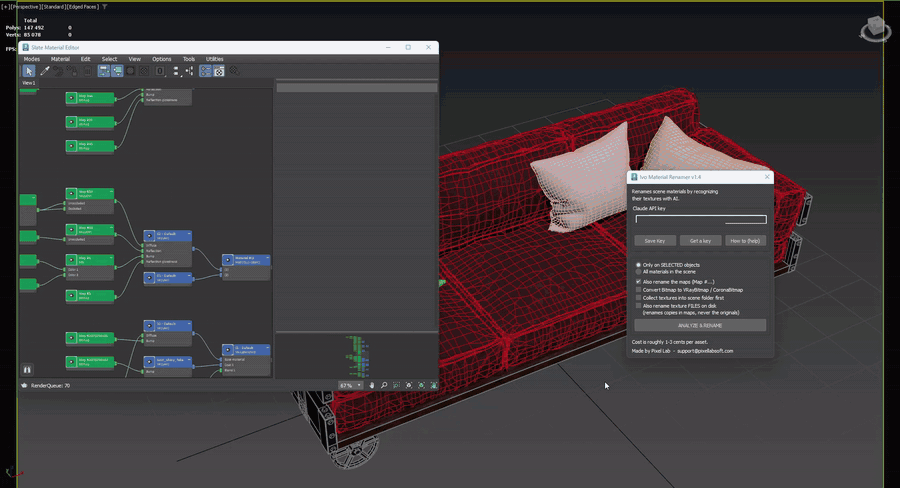

# Ivo Material Renamer for 3ds Max — v1.4.1



Gives your materials real names. Instead of `Material #36`, `02` or `VRayMtl_07`
you get `Oak_Wood`, `Brushed_Steel`, `Oyster_Shell`.

It shows Claude a picture of every part of your model, gets a name back for each
material, shows you the full list, and renames only after you confirm.
Duplicates are numbered `_001`, `_002` automatically.

---

## What it does

* Reads the materials of the selected objects (or of the whole scene)
* Takes a picture of the part each material is on, and looks at its texture
  and settings
* Proposes a descriptive name for every material
* Shows the proposals — nothing is renamed until you confirm
* Numbers duplicates `_001`, `_002`, …
* Gives the maps readable names too — no more `Map #2070298415`
* Optionally converts plain Bitmaps to VRayBitmap / CoronaBitmap
* Optionally copies the textures into the scene's own folder first
* Optionally renames the texture **files** on disk to match, and fixes the paths
  in the scene

Works with VRayMtl, Physical Material, Standard, CoronaPhysicalMtl and the
older CoronaMtl, and with Bitmap, VRayBitmap, CoronaBitmap and OSLMap textures,
also when they sit inside Composite, Color Correction, Falloff, CoronaMultiMap
and similar maps.

Container materials — Multi/Sub-Object, Blend, Double Sided, VRayBlendMtl,
CoronaLayeredMtl — get a name for the whole object, and every material inside
them gets its own.

Downloaded models often point at the author's own folders (`D:\3ds max\...`)
or at a bare file name. The tool then looks for the file by name next to the
scene and up to three folders below it (`Maps`, `Texture`, …).

## How it works

1. **Collects the materials** of the selection (or the whole scene), including
   every material inside Multi/Sub-Object and other container materials.
2. **Takes a picture of each part.** For every material the tool shows only the
   faces that use it — everything else is hidden for a moment — zooms in and
   grabs the viewport. Your objects are never changed: it works on a temporary
   copy of the mesh, deletes it right after, and puts back hidden objects,
   selection and the view exactly as they were (camera views included).
3. **Adds what the picture cannot show:** how much of the model the part covers,
   whether it sits at the top, middle or bottom, whether it is a volume inside
   another part (a liquid in a bottle), the material's key settings
   (refraction, IOR, fog colour, metalness, glossiness) and its texture.
4. **Asks Claude** to name each material from its own picture — in batches of
   30, so the size of the scene does not matter.
5. **Shows you the list.** Nothing is renamed until you press Yes.
6. Optionally **collects and renames the texture files** — see below.

One run costs roughly 1–3 US cents per asset, paid to Anthropic through your own
API key. The Listener (F11) shows every step, including the faces, share and
height of each part.

## Requirements

* 3ds Max 2021 or newer (needs Python 3)
* Pillow — if the tool says it is missing, open a terminal in
  `<3ds Max install folder>\Python` and run
  `.\python.exe -m pip install --user pillow`
* Internet access
* An Anthropic (Claude) API key — see below

## Install

1. Keep **both** files in the same folder:
   * `Ivo_Material_Renamer.ms`
   * `Ivo_Material_Renamer.py`
2. In 3ds Max: **Scripting → Run Script…** and pick the `.ms` file. The tool opens.
3. Optional toolbar button: **Customize → Customize User Interface → Toolbars**,
   Category **Ivo Tools**, drag **Mat Renamer** onto a toolbar.

If you move the folder later, run the `.ms` once from the new location so the
button points at the right file.

## API key

1. Go to <https://console.anthropic.com> and create an account
2. **Settings → API keys → Create Key**, copy it immediately (shown only once)
3. **Settings → Billing → Buy credits** — $5–10 covers hundreds of assets
4. Paste the key in the tool and press **Save Key**

The key is stored locally in `<plugcfg>\IvoMaterialRenamer.ini`. It never goes
anywhere except to Anthropic's API. You can also set an `ANTHROPIC_API_KEY`
environment variable instead and leave the field empty.

**Cost:** roughly 1–3 US cents per asset. You pay Anthropic directly through
your own account — this tool takes no cut and has no server of its own.

## Map names (on by default)

**Also rename the maps** names every map after its material and slot: the map
in the Diffuse slot of `Pillow_Fabric` becomes `Pillow_Fabric_Diff`, a Falloff
or Color Correction inside it `Pillow_Fabric_Diff_Falloff`,
`Pillow_Fabric_Diff_ColorCorrection`, and the bitmaps under them
`Pillow_Fabric_Diff_Map`, `Pillow_Fabric_Diff_Map_2`. The mask of a Blend,
VRayBlendMtl or CoronaLayeredMtl is named after that material: `Rug_Blend_Mask`.
A map shared by several materials is named after the first one.

## Bitmap → VRayBitmap / CoronaBitmap (optional, off by default)

**Convert Bitmap to VRayBitmap / CoronaBitmap** replaces every plain Bitmap
under a V-Ray material with a VRayBitmap, and under a Corona material with a
CoronaBitmap — also inside Falloff, Color Correction and similar maps. The file,
tiling, offset, angle, blur, mirroring, mapping channel, output and cropping are
carried over, and every material that used the map gets the new one. Bitmaps of
other materials (Standard, Physical) are left alone. One Ctrl+Z undoes the
conversion.

## Renaming texture files (optional, off by default)

The checkbox **Also rename texture FILES on disk** renames the image files to
match the new material names:

```
Map #2037_16.png   ->   Oyster_Shell_Diff.png
OSLMap_27.png      ->   Oyster_Shell_Rough.png
```

**Your original files are never renamed.** The textures are first copied into
`<scene folder>\maps\` and only those copies get the new names, so any other
scene that uses the originals keeps working. (That is why ticking this box
also ticks *Collect textures* below.)

Safety rules built in:

* available only in **Only on SELECTED objects** mode
* renames only copies this tool made for this scene — it keeps a small list of
  them in `maps\.ivo_material_renamer.json`
* never overwrites an existing file (adds `_001` if needed)
* shows the full list and asks again before copying and before renaming
* updates all bitmap paths in the scene

Save your scene after renaming so the new paths are stored.

If the scene has never been saved, the tool offers **Save As** first, because
the files need the scene's folder. Say no and only the material names change.

## Collecting textures into the scene folder (new in 1.1)

Textures often live in a shared library, outside the scene's folder. Tick
**Collect textures into scene folder first** and the tool:

* **copies** every texture of the selected materials that sits outside the
  scene's folder into `<scene folder>\maps\` — the originals are never touched
* points the maps in the scene at the copies
* copies a texture used by several materials only once
* never overwrites: a different file with the same name gets `_001`
* shows the list and asks before copying

With renaming on, textures already inside the scene folder are copied too,
so that only copies get renamed. No Resource Collector needed. Save the scene
afterwards to keep the new paths.

## Tips

* It works on the **selection** by default, so it will not touch the rest of your
  scene. Switch to "All materials in the scene" only if you mean it.
* Run it **after** textures are assigned — that is what the AI looks at.
* Undo does not cover material renaming. Save before a big run.

## Support

Found a bug or want a feature? Write to **support@pixellabsoft.com** — made by Pixel Lab.

If the tool is useful, you can support it on Gumroad — pay what you want,
zero is fine. _(link coming)_

## License

MIT — see [LICENSE](LICENSE). Do what you like with it, just keep the notice.

Not affiliated with Autodesk or Anthropic.
